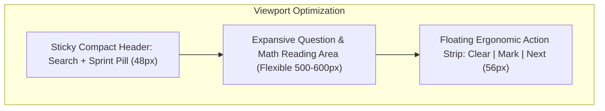

# GateX: Senior UI/UX Design System & Specification Document

---

## 1. Executive Design Philosophy

**GateX** is built specifically for serious aspirants preparing for the **GATE Data Science & Artificial Intelligence (DA)** and **GATE Computer Science & Information Technology (CS/IT)** exams.

During the final 3-month preparation phase, competitive aspirants suffer from cognitive overload, anxiety, and extreme time scarcity. The design system therefore adheres to four strict principles:

1. **Zero Distraction (Focus-First)**: No flashy non-essential animations, no unsolicited popups, and zero third-party coaching marketing. Every pixel serves active learning or time-saving.
2. **True-to-CBT Fidelity**: Mock test interfaces, scoring calculators, formula sheets, and numerical pads must replicate official GATE Computer-Based Test (CBT) paradigms.
3. **Ergonomic Speed & Thumb-Zone Reachability**: Primary study actions (submitting answers, toggling solutions, reviewing formulas, clearing choices) must be reachable within one-handed thumb arcs.
4. **Active Recall over Passive Scanning**: Reading static lists is ineffective. The UI facilitates immediate retrieval practice through flashcard flips, quick quizzes, and numerical typing drills.

---

## 2. Design Tokens & Visual Foundations

### 2.1 Color Palette & Theme Tokens

```
=============================================================================
TOKEN                  LIGHT THEME           DARK THEME (Default)   USAGE
=============================================================================
Background Primary     #F8F9FD               #0F0F14                App canvas
Surface Elevated       #FFFFFF               #1A1A24                Cards, bottom sheets
Surface Glass          rgba(255,255,255,0.8) rgba(26,26,36,0.85)   Floating modals
Brand Primary          #6C63FF               #6C63FF                Key CTAs, active tabs
Brand Secondary        #00B894               #00D4AA                Accents, countdowns, streaks
Accent Warning         #F59E0B               #FBBF24                Urgency markers, bookmarks
Semantic Error         #EF4444               #FF5C5C                Wrong answers, negative marks
Semantic Success       #10B981               #4CAF50                Correct answers, completed items
Text Primary           #111827               #FFFFFF                Headings, math text
Text Secondary         #6B7280               #9090A0                Metadata, subheadings, labels
Border Subtle          #E5E7EB               rgba(255,255,255,0.08) Divider lines, card outlines
=============================================================================
```

> **WCAG AA Compliance Notice**:
> In dark mode, all badge backgrounds must maintain a minimum contrast ratio of 4.5:1 against their text labels. Badges using low-alpha overlays (e.g. `0.08` opacity) have been replaced with minimum `0.18` background alpha paired with vivid font colors.

---

### 2.2 Typography Hierarchy

* **Heading / Display**: `GoogleFonts.poppins`
  * Strong geometric presence, modern and inspiring.
  * *Scale*: H1 24sp (Bold), H2 18sp (SemiBold), H3 15sp (Medium).
* **Body / Reading**: `GoogleFonts.inter`
  * Exceptional legibility at small sizes, optimal kerning for programming symbols, SQL statements, and math variables.
  * *Scale*: Body Large 15sp (Regular, height 1.5), Body Medium 13sp (height 1.4), Caption 11sp (height 1.3).
* **Timers, Scores & Numerics**: `GoogleFonts.spaceGrotesk`
  * Tabular numerals prevent jitter during live mock test countdowns and statistical score estimation displays.

---

## 3. Ergonomics & Viewport Layout Architecture



---

## 4. Key Component Design Specifications

### 4.1 Component 1: Floating Picture-in-Picture (PiP) Virtual Calculator

* **Problem Solved**: Previous 70% bottom sheet blocked the question text while calculating.
* **Component Architecture**:
  * An interactive overlay card anchored at the bottom-right or top-right.
  * **Draggable**: Drag handle allows freely moving the calculator anywhere on the viewport.
  * **Dual Modes**:
    1. *Minimized Pill*: 48×48px circular icon showing current accumulator value.
    2. *Expanded Floating Box*: 280px wide × 360px high with scientific keys, a clear LCD output, and a transparency toggle button (`Opacity: 100% -> 75% -> 50%`) enabling students to see question text directly underneath.
  * **CBT Realism**: Key layout mimics TCS iON GATE Virtual Calculator layout (trigonometric functions, natural log, inverse, scientific exponents, square roots, factorial, memory registers).

---

### 4.2 Component 2: Compact Collapsible PYQ Search & Sticky Filter Bar

* **Problem Solved**: Eliminated ~190px of stacked search bars and pills that previously pushed the first question below the fold.
* **Component Architecture**:
  * Single-row unified bar (height 48px):
    * Left: Search input field with auto-complete.
    * Right: Filter Icon Button with dynamic badge count (e.g. `[3]` when subject, year, and difficulty filters are active).
  * Tapping the filter icon triggers a **clean bottom drawer** displaying:
    * Segmented buttons for Subject (DA / CSIT subjects).
    * Horizontal picker for Year (1991–2026).
    * Radio chips for Type: All, MCQ, MSQ, NAT.
  * Recovers **30% of screen real estate** instantly.

---

### 4.3 Component 3: Exam Simulator Fidelity & Ergonomic Controls

* **Problem Solved**: Eliminated thumb fatigue from 65 repetitive button presses and added missing official GATE exam options.
* **Component Architecture**:
  * **Horizontal Gesture Navigation**: Swipe left for next question, swipe right for previous question, equipped with light haptic feedback (`HapticFeedback.selectionClick()`).
  * **Explicit GATE Actions**:
    * **"Clear Response"** (Reverts answer state, updates question palette back to Unanswered).
    * **"Mark for Review & Next"** (Highlights purple in question palette).
    * **"Save & Next"** (Highlights green in question palette).
  * **Question Navigator Grid Drawer**: Displays 5-column numbered grid indicating status with official color codes:
    * Green: Answered.
    * Purple: Marked for review.
    * Orange/Red: Not answered.
    * Grey: Not visited.

---

### 4.4 Component 4: Active Recall Formula Flashcards

* **Problem Solved**: Transforms 1,594 lines of static reference formulas into engaging retrieval practice.
* **Component Architecture**:
  * **Two View Modes**:
    1. *Quick Reference Mode*: Categorized vertical list with copy/bookmark controls.
    2. *Flashcard Review Mode*: 
       * Card Front: Question / Concept Name (e.g., *Bayes Theorem Formula for Multiple Partitions*).
       * User mentally attempts recall -> Taps card -> Smooth 3D Y-axis flip animation reveals complete LaTeX derivation.
       * Bottom action buttons: "Still Learning" (re-queues) vs "Mastered" (advances mastery score).

---

### 4.5 Component 5: Final 90-Day Sprint Dashboard

* **Problem Solved**: Late-arriving October/November students no longer see a demotivating May-based schedule.
* **Component Architecture**:
  * Prominent toggle on Home Screen: **"Full Syllabus Plan"** vs **"⚡ 90-Day Sprint Mode"**.
  * **Sprint Mode Widget**:
    * Priority-ranked subject modules based on historical weightage:
      * **Tier 1 (Do or Die ~55M)**: General Aptitude, Probability & Statistics, Machine Learning, Linear Algebra.
      * **Tier 2 (Core Scoring ~25M)**: Calculus & Optimization, DBMS, AI.
      * **Tier 3 (Booster ~10M)**: Python & Algorithms.
    * Daily 15-Minute Rapid Fire card: "Solve 10 random high-yield questions before midnight".

---

### 4.6 Component 6: GateX Pro Season Pass Paywall (Direct-to-Student)

* **Problem Solved**: High-converting, student-respecting monetization without third-party coaching ads.
* **Visual Presentation**:
  * Premium dark glassmorphic card with subtle violet gradient outline.
  * Direct headline: *"GateX Pro: Maximum Focus for the Final 90 Days"*.
  * Clear comparison matrix:
    * Free Tier: Complete PYQ Bank + Virtual Calculator + Study Planner.
    * Pro Tier (₹199 / ₹249 One-Time): 100% Ad-Free + 10 Full CBT Mocks + Printable PDF Formula Cheat Sheets + Error Log Custom Test Generator.
  * Prominent security & independence badge: *"100% Independent. No coaching promotions. Student-first software."*
