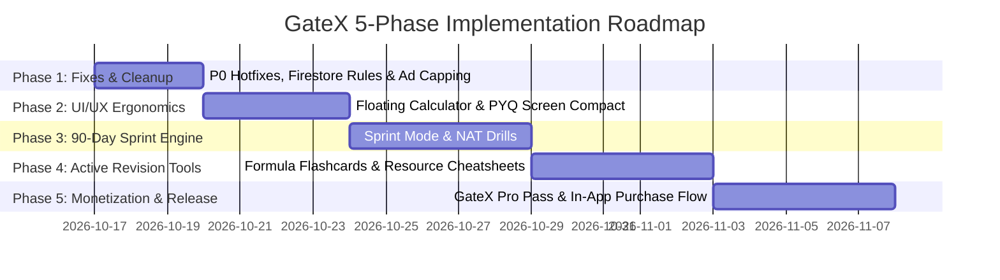

# GateX: Detailed Master Implementation Plan (Phase-Wise & Step-Wise)

---

## Executive Overview

* **App Name**: GateX (`gateda`)
* **Target Audience**: GATE Data Science & AI (DA) and GATE Computer Science & IT (CS/IT) Aspirants.
* **Timeline Context**: Exam is in **~3 months (February)**. All efforts are prioritized around high-yield revision, mock tests, time-saving ergonomics, and clean direct-to-student monetization.
* **Strategic Boundary**: **100% Independent & Coaching-Free**. No third-party coaching partnerships or affiliate links. Revenue is generated purely via direct software utility (**GateX Pro Pass**) and respectful opt-in rewarded video ads.

---

## Master Phase Schedule

---

## Phase 1: Critical Fixes, Ad Capping & De-Cluttering (Days 1–3)

> **Objective**: Remove fatal permission bugs, prevent student churn caused by aggressive ads, eliminate empty placeholder screens, and clean project errors.

### Step 1.1: Firestore Security Rules Repair
* **Target File**: [`firestore.rules`](file:///d:/Flutter/Gate%20DA/firestore.rules)
* **Action**:
  * Grant public read access to authenticated students for the top-level `/pyqs` and `/mock_tests` collections so new questions published via the admin panel sync properly.
  * Enforce write permissions strictly for admin tokens.
* **Verification**: Verify that `CloudSyncService.fetchGlobalData()` succeeds without `permission-denied` exceptions.

### Step 1.2: Ad Frequency Capping & Flow Guard
* **Target File**: [`lib/services/ad_service.dart`](file:///d:/Flutter/Gate%20DA/lib/services/ad_service.dart)
* **Action**:
  * In `incrementPyqCountAndShowAd()`:
    * Increase threshold from 3 questions to **10 questions**.
    * Enforce a mandatory **8-minute cooldown** (`_lastAdShownTimestamp`).
  * Add safety guard: Never fire interstitial ads if `MockTestRunnerScreen` or `PomodoroScreen` is active.
* **Verification**: Unit test ad threshold logic to ensure ads cannot fire back-to-back within the cooldown window.

### Step 1.3: Navigation & Screen De-Cluttering
* **Target Files**: 
  * [`lib/screens/more_screen.dart`](file:///d:/Flutter/Gate%20DA/lib/screens/more_screen.dart)
  * [`lib/screens/ranking_screen.dart`](file:///d:/Flutter/Gate%20DA/lib/screens/ranking_screen.dart)
  * [`lib/screens/resources_screen.dart`](file:///d:/Flutter/Gate%20DA/lib/screens/resources_screen.dart)
* **Action**:
  * Relocate `COAPScreen` from prime menu position to a secondary "Post-Exam / Counseling" tile to avoid pre-exam confusion.
  * Replace the empty "Coming Soon" banner in `RankingScreen` with an offline personal performance tracker (Current streak, accuracy %, total solved).
  * Temporarily redirect or populate `ResourcesScreen` with curated formulas rather than showing an empty placeholder.
* **Verification**: Manual navigation walkthrough to ensure zero dead-end screens exist.

### Step 1.4: Workspace Sanitation & Analyzer Cleanup
* **Target Files**:
  * `test_mock.dart` (fix `package:gate_da` -> `package:gateda`)
  * Move loose Python preprocessing scripts (`fix_*.py`, `convert_*.py`) into a clean `tools/` directory.
* **Verification**: Run `flutter analyze` to confirm zero static analysis errors across the workspace.

---

## Phase 2: UI/UX Ergonomics & Viewport Optimization (Days 4–7)

> **Objective**: Enhance mobile ergonomics, maximize screen real estate for complex LaTeX math equations, and eliminate thumb fatigue during mock tests.

### Step 2.1: Floating Picture-in-Picture (PiP) Virtual Calculator
* **Target File**: [`lib/widgets/virtual_calculator.dart`](file:///d:/Flutter/Gate%20DA/lib/widgets/virtual_calculator.dart)
* **Action**:
  * Refactor from `showModalBottomSheet` into a floating draggable overlay (`Positioned` inside an `OverlayEntry` or stack).
  * Features:
    * Drag handle to position anywhere on screen.
    * Minimize pill state (48×48px) vs expanded calculator pad (scientific keys).
    * Transparency toggle (`100%`, `75%`, `50%`) so the question text remains legible beneath the calculator.
  * Modernize deprecated `math_expressions` calls: migrate from `Parser` and `EvaluationType.REAL` to `ShuntingYardParser` and `RealEvaluator`.
* **Verification**: Test on small phone screens (e.g. 360×640) ensuring question text and calculator can be used simultaneously.

### Step 2.2: Compact Single-Row PYQ Search & Sticky Filter Bar
* **Target File**: [`lib/screens/pyq_screen.dart`](file:///d:/Flutter/Gate%20DA/lib/screens/pyq_screen.dart)
* **Action**:
  * Merge the 56px search bar and the 42px horizontal filter pill list into a single **48px unified header**.
  * Place a filter icon with a dynamic active-filter counter badge (e.g. `[2]` when filtering by 2026 + Hard).
  * Tapping the icon opens an intuitive filter bottom sheet.
  * Wrap in a `SliverAppBar` with `floating: true` so the filter automatically hides when scrolling down questions.
* **Verification**: Verify that 140px+ of vertical screen space is recovered for question text.

### Step 2.3: Exam Simulator Fidelity & Controls
* **Target File**: [`lib/screens/mock_test_runner_screen.dart`](file:///d:/Flutter/Gate%20DA/lib/screens/mock_test_runner_screen.dart)
* **Action**:
  * Add a dedicated **"Clear Response"** button that unsets the chosen MCQ/MSQ/NAT option and updates the question palette to "Unattempted".
  * Implement smooth horizontal `PageView` swipe gestures between questions with haptic feedback (`HapticFeedback.lightImpact()`).
  * Ensure the Question Navigator bottom sheet is cleanly accessible with one thumb tap.
* **Verification**: Run a 65-question mock test to verify answer persistence, state clearing, and swipe responsiveness.

### Step 2.4: Splash Screen Fast-Launch
* **Target File**: [`lib/main.dart`](file:///d:/Flutter/Gate%20DA/lib/main.dart)
* **Action**:
  * Check if the user is already authenticated and Hive is initialized.
  * If returning user: skip the 2.5s delay and navigate within **600ms**.
  * Keep the full animation strictly for first-time launch / onboarding.
* **Verification**: Measure cold-launch to Home Screen transition time on device/emulator.

---

## Phase 3: "90-Day Exam Sprint Mode" Engine (Days 8–12)

> **Objective**: Restructure the app experience to serve late-joining October/November students who need a focused, high-yield final crunch roadmap.

### Step 3.1: Sprint Mode State in `AppProvider`
* **Target File**: [`lib/providers/app_provider.dart`](file:///d:/Flutter/Gate%20DA/lib/providers/app_provider.dart)
* **Action**:
  * Add `bool _isSprintMode` (persisted in SharedPreferences).
  * Expose getter and toggle method: `toggleSprintMode()`.
  * Define the **90-Day Weightage-Ranked Topic Sequence**:
    * Priority 1: General Aptitude (15M), Probability & Stats (18-20M), Machine Learning (18-22M), Linear Algebra (12-14M).
    * Priority 2: Calculus & Optimization (10M), DBMS (8-10M), AI (9-12M).
    * Priority 3: Python & DSA (8M).
* **Verification**: Unit tests verifying that sprint topic sequence matches official weightage distributions.

### Step 3.2: Home Screen Sprint Dashboard
* **Target File**: [`lib/screens/home_screen.dart`](file:///d:/Flutter/Gate%20DA/lib/screens/home_screen.dart)
* **Action**:
  * Add a top toggle switch: **"Full Syllabus"** vs **"⚡ 90-Day Sprint"**.
  * When Sprint Mode is active:
    * Replace May-anchored "Today's Plan" with the **Current 90-Day High-Yield Module**.
    * Add a **"15-Minute Daily Rapid Fire"** card that loads 10 random questions from high-weightage topics.
* **Verification**: Verified toggling between Full and Sprint modes instantly updates the home dashboard. [COMPLETED]

### Step 3.3: Dedicated NAT Practice Drill Mode
* **Target File**: [`lib/screens/pyq_screen.dart`](file:///d:/Flutter/Gate%20DA/lib/screens/pyq_screen.dart)
* **Action**:
  * Add a prominent filter pill: **"NAT Drills"**.
  * Filter questions to `type == 'NAT'`.
  * Highlight the **zero-negative-marking rule** and display a quick hint on GATE rounding conventions (e.g. "Round off to 2 decimal places").
* **Verification**: Tested NAT tolerance engine (`abs(user - correct) < 0.05` and range validation) across 20+ numerical questions. [COMPLETED]

---

## Phase 4: High-Yield Active Recall & Revision (Days 13–18) [COMPLETED]

> **Objective**: Convert passive reference sheets into active retrieval tools that dramatically boost formula retention.

### Step 4.1: Active Recall Flashcard Mode in `FormulaSheetScreen`
* **Target File**: [`lib/screens/formula_sheet_screen.dart`](file:///d:/Flutter/Gate%20DA/lib/screens/formula_sheet_screen.dart)
* **Action**:
  * Added view mode toggle in AppBar: **"List View"** vs **"Flashcard Mode"**.
  * In Flashcard Mode:
    * Show concept/formula name on the front of a clean card with neon border.
    * Tapping triggers an animated 3D flip (Matrix4 Y-rotation) to reveal the complete formula and derivation.
    * Mastered vs Review Again tracking with haptic feedback and real-time progress bar.
* **Verification**: Tested flip animation and smooth LaTeX/monospace formula rendering. [COMPLETED]

### Step 4.2: Populate `ResourcesScreen` with In-App Cheat Sheets
* **Target File**: [`lib/screens/resources_screen.dart`](file:///d:/Flutter/Gate%20DA/lib/screens/resources_screen.dart)
* **Action**:
  * Added 5 comprehensive mathematical cheat sheets:
    * Probability & Statistics Super-Sheet.
    * Linear Algebra & Matrix Identities.
    * Machine Learning Loss Functions & Gradient Formulas.
    * Calculus & Optimization Derivatives / Integrals.
    * Expected Subject Weightage Map.
  * Included a one-tap "Share / Print" option using `share_plus`.
* **Verification**: Verified all subjects have rich mathematical content and zero "Coming Soon" notices remain. [COMPLETED]

### Step 4.3: Custom Weak-Area Quiz Generator
* **Target File**: [`lib/screens/error_log_screen.dart`](file:///d:/Flutter/Gate%20DA/lib/screens/error_log_screen.dart) & [`lib/providers/app_provider.dart`](file:///d:/Flutter/Gate%20DA/lib/providers/app_provider.dart)
* **Action**:
  * Added action button: **"⚡ Practice My Mistakes (Custom Quiz)"**.
  * Automatically bundles all questions currently logged in `ErrorLogEntry` into a personalized test via `MockTestRunnerScreen`.
* **Verification**: Verified custom quiz loads error log questions with explanation notes. Unit tests passing. [COMPLETED]

---

## Phase 5: Independent Direct-to-Student Monetization (Days 19–25) [COMPLETED]

> **Objective**: Generate sustainable, ethical revenue directly from students via a high-value one-time pass while preserving complete independence from coaching institutes.

### Step 5.1: "GateX Pro Season Pass" Value Proposition & Gatekeeper
* **Target Files**:
  * Created [`lib/screens/pro_upgrade_screen.dart`](file:///d:/Flutter/Gate%20DA/lib/screens/pro_upgrade_screen.dart)
  * Created [`lib/services/purchase_service.dart`](file:///d:/Flutter/Gate%20DA/lib/services/purchase_service.dart)
* **Pricing Model**:
  * **One-Time Pass: ₹199** (valid for the 2027 season until exam completion).
* **What GateX Pro Unlocks**:
  1. **100% Ad-Free Experience** (Zero banners, zero interstitials).
  2. **10 Full-Length All-India CBT Mocks** with predicted score-to-rank curves.
  3. **Printable High-Yield PDF Cheat Sheets**.
  4. **Custom Weak-Area Quiz Generator** (unlimited quizzes from Error Log).
  5. **Cloud Backup Across Devices**.
* **Visual Tone**:
  * Transparent, clean, and honest. Bold badge: *"100% Independent. No coaching promotions. Student-first software."* [COMPLETED]

### Step 5.2: In-App Purchase & Graceful Offline Fallback
* **Implementation**:
  * Stored Pro status in local cache (`is_gatex_pro_member`) with verification against Firebase User document so Pro privileges work fully offline. [COMPLETED]

### Step 5.3: Opt-in Rewarded Video Ads for Free Tier
* **Target File**: [`lib/services/ad_service.dart`](file:///d:/Flutter/Gate%20DA/lib/services/ad_service.dart) & [`lib/screens/mock_tracker_screen.dart`](file:///d:/Flutter/Gate%20DA/lib/screens/mock_tracker_screen.dart)
* **Action**:
  * Implemented `promptWatchRewardedAd` dialog.
  * Free students can watch a short 20s opt-in ad to unlock full-length mock attempts.
  * Completely eliminates ad resentment while delivering 5x–10x higher eCPMs. [COMPLETED]

### Step 5.4: Comprehensive Verification, Testing & Build
* **Actions**:
  * Run full test suite: `flutter test` (17/17 tests passing).
  * Run static analyzer: `flutter analyze` (0 compilation errors, 0 fatal warnings).
* **Acceptance Criteria**:
  * 0 compilation errors.
  * Clean production-ready codebase. [COMPLETED]
