# GateX: Complete End-to-End Rebuilding Plan & Screen Architecture

---

## 1. Complete Screen & Sub-Screen Feature Hierarchy

Before rebuilding, here is the complete architectural map of every screen, nested sub-screen, bottom sheet, modal, and drawer in GateX:

```
                                  GATEX SCREEN HIERARCHY
  ┌────────────────────────────────────────────────────────────────────────────────────────┐
  │ 0. ENTRY & AUTHENTICATION FLOW                                                         │
  │    ├── SplashScreen (Fast-boot Hive cache check; 600ms returning vs 1200ms new)        │
  │    ├── LoginScreen (Email/Pass, Google Login, Guest Access)                            │
  │    │    ├── ForgotPasswordScreen (Password reset email trigger)                        │
  │    │    └── SignUpScreen (Registration with 6-char pass verification)                  │
  │    └── ExamSelectionScreen (Branch selection: DA, CSIT, or Both with confirmation)   │
  └───────────────────────────────────────────┬────────────────────────────────────────────┘
                                              │
  ┌───────────────────────────────────────────┴────────────────────────────────────────────┐
  │ MAIN NAVIGATION SCAFFOLD (5 Primary Root Tabs)                                         │
  │                                                                                        │
  │ ├── TAB 0: HOME SCREEN (Student Command Center)                                        │
  │ │    ├── Exam Switcher (DA / CSIT toggle pill for dual-branch preppers)                │
  │ │    ├── Milestone Hero Card (Days left, weeks/months remaining, prep runway)          │
  │ │    ├── Today's Target Card (Topic, hours, single CTA -> Jumps to Planner)            │
  │ │    ├── Metric Snapshot Strip (Topics covered, PYQs solved, Mocks taken)              │
  │ │    └── Study Tools Grid (Quick access to PYQs, Mocks, Formulas, Error Log)           │
  │ │                                                                                      │
  │ ├── TAB 1: STUDY PLANNER SCREEN                                                        │
  │ │    ├── Daily Plan Tab (Horizontal calendar date strip, day detail card, note modal)  │
  │ │    └── Phase Overview Tab (Subject modules, weightage, phase completion status)      │
  │ │                                                                                      │
  │ ├── TAB 2: PYQ PRACTICE SCREEN                                                         │
  │ │    ├── Search Bar & Filter Drawer (Subject, Year, Difficulty, NAT-only toggle)       │
  │ │    ├── Tabs: All, Bookmarked, Completed, Revision Queue                              │
  │ │    ├── Question Card (LaTeX body, diagram modal preview, MCQ/MSQ/NAT input)          │
  │ │    ├── Solution & Explanation Drawer (Step-by-step mathematical derivation)          │
  │ │    ├── [NEW] Question Doubt Discussion Drawer (💬 Peer discussions & shortcuts)      │
  │ │    └── Floating Virtual Calculator Action (Draggable PiP overlay)                    │
  │ │                                                                                      │
  │ ├── TAB 3: SYLLABUS & ROADMAP SCREEN                                                   │
  │ │    ├── Subject-wise dependency breakdown & syllabus tree                             │
  │ │    └── Topic Detail Bottom Sheet (Completion toggle, notes editor, resource links)   │
  │ │                                                                                      │
  │ └── TAB 4: MORE & SETTINGS SCREEN                                                      │
  │      ├── Profile Summary Card ──▶ ProfileScreen (Edit profile, reset progress dialog) │
  │      ├── Pro Pass Banner ──▶ ProUpgradeScreen (RevenueCat Google Play / UPI paywall)   │
  │      ├── Study Tools Sub-Screens:                                                      │
  │      │    ├── MockTrackerScreen (Score chart, mock test library, manual log sheet)     │
  │      │    │    └──▶ MockTestRunnerScreen (Official GATE CBT 5-color examination engine)│
  │      │    ├── ErrorLogScreen (Mistakes journal, "Why Wrong" sheet, custom quiz runner) │
  │      │    ├── FormulaSheetScreen (Concept cheat sheets, LaTeX formulas, flashcards)    │
  │      │    ├── ScoreEstimatorScreen (Raw marks to rank/IIT cutoff predictor modal)      │
  │      │    ├── WeightageScreen (Subject marks distribution & high-yield priorities)     │
  │      │    ├── RevisionScreen (Spaced repetition queue & priority badges)               │
  │      │    ├── RankingScreen (Peer percentiles & personal analytics)                    │
  │      │    ├── ResourcesScreen (Curated reference sheets & study material)              │
  │      │    ├── PomodoroScreen (Focus timer, break timer, audio alert dialog)            │
  │      │    └── COAPScreen (Post-exam IIT M.Tech admission cutoff guide)                 │
  │      └── App Settings (Notification time picker, streak toggle, cloud sync, logout)   │
  └────────────────────────────────────────────────────────────────────────────────────────┘
```

---

## 2. Rebuilding Sequence: Why Product First, Monetization Last

```mermaid
graph TD
    P1["Phase 1: Foundation & Clean Ergonomics<br/>• Standard Native Bottom Bar<br/>• Snapnotes Navy/Electric Blue Theme<br/>• Clean Auth & Fast Boot Splash"]
    
    P2["Phase 2: Official GATE CBT Simulator<br/>• 5-State Question Palette<br/>• Aptitude vs Core Section Tabs<br/>• Clear Response & Mark for Review<br/>• PiP Floating Virtual Calculator"]
    
    P3["Phase 3: PYQ Engine & Ingestion Pipeline<br/>• Compact Search & Filter Bottom Sheet<br/>• Python AI PDF Question Extractor<br/>• Admin CSV / Google Sheets Sync<br/>• Downloadable Branch Packs"]
    
    P4["Phase 4: Mistake Notebook & Active Revision<br/>• Error Log with 'Why Wrong' Taxonomy<br/>• Custom Mistake Drill Quiz Runner<br/>• Spaced Revision Queue<br/>• Agile Syllabus Checklist"]
    
    P5["Phase 5: Community & Peer Doubt Solving<br/>• Question-Level Discussion Drawer<br/>• Firestore Discussion Schema with Upvotes<br/>• Categorized Doubt Boards<br/>• Anti-Spam & Rate Limiter"]
    
    P6["Phase 6: Multi-Branch Scalable Architecture<br/>• Modular BranchConfig Abstraction<br/>• Decouple Hardcoded Exam Logic<br/>• Plug-and-Play ECE, EE, ME, CE Next Season"]

    P7["Phase 7: Retention, Monetization & Release<br/>• RevenueCat purchases_flutter Setup<br/>• Season Pro Pass Paywall (₹199 / ₹249)<br/>• Rewarded Ad Integration (Free Tier)<br/>• 9 AM Daily Push & 1-Click PDF Exports<br/>• Play Store App Bundle Build"]

    P1 --> P2 --> P3 --> P4 --> P5 --> P6 --> P7
```



---

## Phase 1: Foundation, Ergonomics & Navigation Core

> **Objective**: Establish the rock-solid visual and navigational foundation matching your signature clean style (`Snapnotes` design language), with fast launch and zero-clutter layouts.

### Step 1.1: Standard Native Bottom Navigation Bar
* **Target File**: [`lib/main.dart`](file:///d:/Flutter/Gate%20DA/lib/main.dart)
* **Action**:
  * Replace the floating pill with a native, edge-to-edge navigation bar anchored cleanly at the bottom.
  * Background: `AppTheme.surface` (`#1D1E33`).
  * Top subtle 1px border (`#18FFFFFF`).
  * Selected tab: Electric blue (`#2962FF`) icon & typography; unselected: muted slate (`#B0BEC5`).
  * Remove bouncy icon scale animations (`AnimatedScale`) and floating dots in favor of native Material crispness.

### Step 1.2: Design System & Color Palette Alignment
* **Target File**: [`lib/theme/app_theme.dart`](file:///d:/Flutter/Gate%20DA/lib/theme/app_theme.dart)
* **Action**:
  * `primary`: Electric Blue (`Color(0xFF2962FF)`).
  * `background`: Dark Navy (`Color(0xFF0A0E21)`).
  * `surface`: Deep Navy (`Color(0xFF1D1E33)`).
  * `secondary / accent`: Mint Cyan (`Color(0xFF00D4AA)`).
  * `cardTheme`: Elevation 0, rounded 16, with subtle 1px border (`Color(0x18FFFFFF)`).

### Step 1.3: Dedicated Auth & Splash Fast-Launch
* **Target Files**: [`lib/screens/login_screen.dart`](file:///d:/Flutter/Gate%20DA/lib/screens/login_screen.dart), [`lib/screens/sign_up_screen.dart`](file:///d:/Flutter/Gate%20DA/lib/screens/sign_up_screen.dart), [`lib/main.dart`](file:///d:/Flutter/Gate%20DA/lib/main.dart)
* **Action**:
  * Preserve separate, clean `LoginScreen` and `SignUpScreen` with Google Sign-in and instant Guest Access.
  * Optimize `SplashScreen`: If user is authenticated and Hive is cached, fast-boot into dashboard within **600ms**.

### Step 1.4: Decluttered Home Screen Command Center
* **Target File**: [`lib/screens/home_screen.dart`](file:///d:/Flutter/Gate%20DA/lib/screens/home_screen.dart)
* **Action**:
  * Milestone Hero Card: Compact horizontal card with bold Days Left countdown, target date badge, and linear prep runway indicator.
  * Today's Target Card: Clean card showing today's subject, topic, and single action button.
  * Metric Snapshot Strip: 3 tiles (Topics Done, PYQs Solved, Mocks Taken).
  * 2x2 Core Tools Grid: Direct entry into PYQ Bank, Mock Tests, Formulas, and Error Log.

---

## Phase 2: Official GATE CBT Simulator (Examination Engine)

> **Objective**: Replicate the exact visual and operational behavior of the official GATE Computer-Based Test (TCS iON CBT engine) so students experience zero unfamiliarity in the actual exam hall.

### Step 2.1: The Official 5-State Question Palette
* **Target File**: [`lib/screens/mock_test_runner_screen.dart`](file:///d:/Flutter/Gate%20DA/lib/screens/mock_test_runner_screen.dart)
* **Action**:
  * Implement the official 5 status indicators:
    1. 🟢 **Answered**: Green polygon with question number.
    2. 🔴 **Not Answered**: Red rectangle (visited, left unanswered).
    3. 🟣 **Marked for Review**: Purple circle (unanswered, marked for review).
    4. 🟣🟢 **Answered & Marked for Review**: Purple circle with an inner green status dot (**evaluated in final score!**).
    5. ⚪ **Not Visited**: Neutral grey card.
  * Top status counter bar in question drawer:
    * `Answered: 32` | `Not Answered: 18` | `Marked: 5` | `Review+Ans: 3`

### Step 2.2: Official Section Switching & Marking Logic
* **Target File**: [`lib/screens/mock_test_runner_screen.dart`](file:///d:/Flutter/Gate%20DA/lib/screens/mock_test_runner_screen.dart)
* **Action**:
  * Add Section Tabs:
    * **Section 1: General Aptitude** (Questions 1–10, 15 Marks).
    * **Section 2: Subject Core** (Questions 11–65, 85 Marks).
  * Action Buttons:
    * **"Save & Next"**: Saves answer and moves forward.
    * **"Clear Response"**: Clears selected radio/checkbox/NAT input and marks status as "Not Answered".
    * **"Mark for Review & Next"**: Sets purple review state.
  * Scoring calculation:
    * 1-mark MCQ: `+1.0` correct, `-0.33` wrong.
    * 2-mark MCQ: `+2.0` correct, `-0.66` wrong.
    * MSQ: Full marks only if all correct options are selected; 0 negative marking.
    * NAT: Evaluated within numerical tolerance range; 0 negative marking.

### Step 2.3: Picture-in-Picture (PiP) Virtual Calculator
* **Target File**: [`lib/widgets/virtual_calculator.dart`](file:///d:/Flutter/Gate%20DA/lib/widgets/virtual_calculator.dart)
* **Action**:
  * Keypad layout aligned with official GATE desktop calculator keys (trig, inverse trig, log10, ln, powers, factorial).
  * Floating draggable window with minimize pill toggle (48px) so students can calculate while reading question text.

### Step 2.4: Shareable Telegram & WhatsApp Scorecard
* **Target File**: [`lib/screens/mock_tracker_screen.dart`](file:///d:/Flutter/Gate%20DA/lib/screens/mock_tracker_screen.dart)
* **Action**:
  * Render an exportable graphic scorecard (Score, Percentile, Accuracy %, Weak Subject Breakdown).
  * 1-tap share to WhatsApp, Telegram study channels, and LinkedIn.

---

## Phase 3: PYQ Engine & Ingestion Pipeline

> **Objective**: Upgrade the question bank with fast search, responsive filters, and build automated ingestion tools to parse official IIT PDFs in 90 seconds.

### Step 3.1: Compact Search & Filter Bottom Sheet
* **Target File**: [`lib/screens/pyq_screen.dart`](file:///d:/Flutter/Gate%20DA/lib/screens/pyq_screen.dart)
* **Action**:
  * Replace crowded filter pills with a sleek search bar and a **Filter Button with active count badge** (e.g. `[2]`).
  * Filter Bottom Sheet (`showModalBottomSheet`):
    * Filter by Subject (multi-select).
    * Filter by Year (2026 down to 2010).
    * Filter by Type (MCQ, MSQ, NAT).
    * Filter by Status (Unsolved, Solved, Bookmarked).

### Step 3.2: Python AI PDF Question Extractor Tool
* **Target File**: Create `tools/extract_gate_pdf.py`
* **Action**:
  * Input: Official IIT Master Question Paper PDF + Official Answer Key PDF.
  * Process:
    1. Parses questions and translates math into clean LaTeX (`$ ... $`).
    2. Automatically crops diagrams/circuit images and uploads to Firebase Storage / assets.
    3. Matches questions with the answer key (MCQ options, NAT acceptable numerical range).
    4. Outputs structured JSON ready for Firestore or local database.
  * **Result**: An entire 65-question paper that used to take 6 hours is finished in 2 minutes.

### Step 3.3: Admin Panel CSV / Google Sheets Sync
* **Target Files**: [`admin_panel/src/pages/UploadPYQ.tsx`](file:///d:/Flutter/Gate%20DA/admin_panel/src/pages/UploadPYQ.tsx), `admin_panel/src/pages/ManagePYQs.tsx`
* **Action**:
  * Add a **"Upload CSV / Sync Google Sheet"** tab alongside JSON upload.
  * Live KaTeX math preview window: As you edit a question, the mathematical equations render in real time on the right-hand panel.

### Step 3.4: Dynamic Cloud Caching in Mobile App
* **Target File**: [`lib/services/cloud_sync_service.dart`](file:///d:/Flutter/Gate%20DA/lib/services/cloud_sync_service.dart)
* **Action**:
  * When a user selects a branch, download that branch's question bundle (`.json.gz`) from Firebase Storage and cache it in local Hive storage.
  * Keeps the base APK download lightweight (~20–25 MB) even when adding 10 branches!

---

## Phase 4: Mistake Notebook & Active Revision

> **Objective**: Empower students to convert mistakes into rank improvements through structured error tracking and agile checklists.

### Step 4.1: Error Log with "Why Wrong" Root-Cause Taxonomy
* **Target File**: [`lib/screens/error_log_screen.dart`](file:///d:/Flutter/Gate%20DA/lib/screens/error_log_screen.dart)
* **Action**:
  * When logging an error from PYQs or Mocks, provide structured tags:
    * ⚠️ `Silly Calculation Error`
    * 🧠 `Conceptual Gap`
    * ⏱️ `Time Pressure / Rush`
    * 🔍 `Misread Question / Trap`
    * 📐 `Formula Forgotten`
  * Bottom sheet to edit custom explanation notes.

### Step 4.2: Automated Custom Mistake Drill Generator
* **Target Files**: [`lib/screens/error_log_screen.dart`](file:///d:/Flutter/Gate%20DA/lib/screens/error_log_screen.dart), [`lib/providers/app_provider.dart`](file:///d:/Flutter/Gate%20DA/lib/providers/app_provider.dart)
* **Action**:
  * Action Button: **"⚡ Practice My Mistakes (Custom Quiz)"**.
  * Dynamically bundles all questions in the Error Log into a customized test session in `MockTestRunnerScreen`.
  * Filter by subject (e.g. "Only Linear Algebra Mistakes").

### Step 4.3: Agile Syllabus Checklist (Replacing May-Start Plan)
* **Target File**: [`lib/screens/planner_screen.dart`](file:///d:/Flutter/Gate%20DA/lib/screens/planner_screen.dart)
* **Action**:
  * Replace the static May-dated timeline with an **Agile Subject Checklist**:
    * Subjects grouped by high-weightage topics.
    * Checkboxes for: *Concept Watched*, *PYQ Solved*, *Revised Once*.
    * Practical for late-joining students who start in October or November.

### Step 4.4: Formula Sheets Active Recall Mode
* **Target File**: [`lib/screens/formula_sheet_screen.dart`](file:///d:/Flutter/Gate%20DA/lib/screens/formula_sheet_screen.dart)
* **Action**:
  * Clean List View as default with subject tabs.
  * Active Recall toggle: Shows concept name; tap to reveal formula with smooth LaTeX rendering.

---

## Phase 5: In-App Community & Peer Doubt Solving

> **Objective**: Drive daily organic student retention through peer learning without creating noisy, unmoderated chatrooms.

### Step 5.1: Question-Level Discussion Drawer
* **Target Files**: [`lib/screens/pyq_screen.dart`](file:///d:/Flutter/Gate%20DA/lib/screens/pyq_screen.dart), [`lib/screens/mock_test_runner_screen.dart`](file:///d:/Flutter/Gate%20DA/lib/screens/mock_test_runner_screen.dart)
* **Action**:
  * Place a **"💬 Discuss"** button under every PYQ and mock test question.
  * Opens a sliding bottom sheet with peer discussions, alternative calculation shortcuts, and LaTeX solutions.

### Step 5.2: Discussion Firestore Schema & Upvoting
* **Target File**: [`lib/services/cloud_sync_service.dart`](file:///d:/Flutter/Gate%20DA/lib/services/cloud_sync_service.dart)
* **Schema**:
  * `/questions/{questionId}/discussions/{commentId}`:
    * `authorUid`: String
    * `authorName`: String
    * `isPro`: Boolean (displays Gold "PRO Ranker" badge)
    * `content`: Text (supports LaTeX syntax `$ ... $`)
    * `upvotes`: Number
    * `createdAt`: Timestamp
  * Local Hive caching: Discussion threads are cached locally to minimize Firestore read costs.

### Step 5.3: Categorized Subject Boards & Anti-Spam Guardrails
* **Target File**: Create `lib/screens/community_screen.dart`
* **Channels**:
  * 📌 `#Machine-Learning-AI`
  * 📌 `#Linear-Algebra-Calculus`
  * 📌 `#General-Aptitude-Tricks`
  * 📌 `#Mock-Exam-Strategy`
* **Anti-Spam Rules**:
  * 2-minute post rate-limiting per user.
  * Automated regex blocking external Telegram links (`t.me/`), WhatsApp links, and phone numbers.

---

## Phase 6: Multi-Branch Scalable Architecture

> **Objective**: Prepare the codebase to expand from CS/IT + DSAI to ECE, EE, Mechanical, and Civil engineering next year with zero structural rewrites.

### Step 6.1: Modular `BranchConfig` Data Abstraction
* **Target File**: Create `lib/models/branch_model.dart`
* **Model**:
  ```dart
  class BranchConfig {
    final String code; // 'DA', 'CSIT', 'EC', 'EE', 'ME', 'CE'
    final String displayName;
    final List<String> subjects;
    final Map<String, int> weightageMap;
    final String formulaAssetPath;
    final String pyqDataFile;
  }
  ```
* Remove hardcoded `if (activeExam == 'DA')` checks across screens; inject `BranchConfig` dynamically via `AppProvider`.

### Step 6.2: Multi-Branch Switcher & Profile Persistence
* **Target File**: [`lib/screens/exam_selection_screen.dart`](file:///d:/Flutter/Gate%20DA/lib/screens/exam_selection_screen.dart)
* **Action**:
  * Dynamic grid of available branches loaded from configuration.
  * User can switch active branch seamlessly from the top AppBar toggle or Settings.

---

## Phase 7: Retention, Monetization (RevenueCat) & Production Release

> **Objective**: Package the completed, high-value app with RevenueCat in-app billing, retention push notifications, printable PDF exports, and publish production builds.

### Step 7.1: RevenueCat Billing Integration (`purchases_flutter`)
* **Target Files**: [`pubspec.yaml`](file:///d:/Flutter/Gate%20DA/pubspec.yaml), [`lib/services/purchase_service.dart`](file:///d:/Flutter/Gate%20DA/lib/services/purchase_service.dart), [`lib/main.dart`](file:///d:/Flutter/Gate%20DA/lib/main.dart)
* **Action**:
  * Add `purchases_flutter: ^8.6.0`.
  * Initialize RevenueCat with Firebase Auth UID.
  * Entitlement: `gatex_pro` (Season Pass ₹199 / ₹249).
  * Auto-suspend ads when active Pro entitlement is detected (`AdService().setAdSuspended(true)`).
  * Implement offline entitlement cache & "Restore Purchases".

### Step 7.2: Production Paywall UI
* **Target File**: [`lib/screens/pro_upgrade_screen.dart`](file:///d:/Flutter/Gate%20DA/lib/screens/pro_upgrade_screen.dart)
* **Action**:
  * Fetch live localized store price from RevenueCat offerings.
  * 1-Tap Google Play Billing sheet supporting UPI (GPay, PhonePe, Paytm), NetBanking, and RuPay cards.
  * Clear listing of Pro entitlements (10 Full Mocks, Unlimited Error Drills, PDF Exports, Ad-free).

### Step 7.3: Automated 9:00 AM "Question of the Day" Push
* **Target File**: [`lib/services/notification_service.dart`](file:///d:/Flutter/Gate%20DA/lib/services/notification_service.dart)
* **Action**:
  * Schedule daily local notification at 9:00 AM with 1 high-yield conceptual question.
  * Tapping launches app directly into that question with explanation.

### Step 7.4: 1-Click Printable PDF Exports
* **Target Files**: [`lib/screens/formula_sheet_screen.dart`](file:///d:/Flutter/Gate%20DA/lib/screens/formula_sheet_screen.dart), [`lib/screens/error_log_screen.dart`](file:///d:/Flutter/Gate%20DA/lib/screens/error_log_screen.dart)
* **Action**:
  * Allow Pro users to export their customized Error Log and Formula Cheatsheets as print-ready PDF files.

### Step 7.5: Final Verification & Google Play App Bundle Build
* **Action**:
  * `flutter analyze` (0 compilation errors).
  * `flutter test` (100% tests passing).
  * Build optimized release App Bundle: `flutter build appbundle --target-platform android-arm,android-arm64`.
