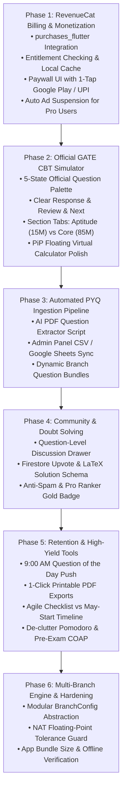

# GateX: End-to-End Master Rebuilding Plan

---

## 1. Executive Summary & Core Requirements

* **Product Name**: GateX (`gateda`)
* **Target Audience**: GATE Aspirants (Active branches: **CS/IT** and **DSAI**; Scalable to **ECE, EE, ME, CE** next season).
* **Current Status**: **350+ organic active users**; rapid influx expected ahead of the February exam.
* **Core Philosophy**: **100% Independent & Coaching-Free**. Zero coaching affiliations, zero sponsored links.
* **Monetization Engine**: **RevenueCat (`purchases_flutter`)** powering a high-conversion **GateX Season Pro Pass** (₹199 – ₹249 one-time purchase via Google Play In-App Billing / UPI), supplemented by non-intrusive rewarded video ads for free users.
* **Primary Differentiators**:
  1. **Official GATE CBT Simulation**: True 5-color examination palette, section switching, and floating virtual calculator.
  2. **Active Learning & Mistake Repair**: Personal Error Log with automated weak-spot drills.
  3. **Structured Community**: Question-level peer discussion threads (avoiding noisy chatroom spam).
  4. **Automated Content Pipeline**: AI PDF question extraction & Google Sheets sync (eliminating manual JSON editing).
  5. **Modular Multi-Branch Architecture**: Dynamic branch abstraction to launch ECE, EE, Mechanical, and Civil without rewriting UI code.

---

## 2. Comprehensive 6-Phase Rebuilding Schedule



---

## Phase 1: RevenueCat Billing & Monetization Engine

> **Objective**: Implement secure, scalable in-app purchases via RevenueCat (`purchases_flutter`), enabling 1-tap UPI, PhonePe, Google Pay, and RuPay card checkouts on Android, with automated offline entitlement caching and ad suppression.

### Step 1.1: Dependency & Android Setup
* **Target Files**: [`pubspec.yaml`](file:///d:/Flutter/Gate%20DA/pubspec.yaml), `android/app/build.gradle`
* **Action**:
  * Add `purchases_flutter: ^8.6.0` to `dependencies`.
  * Ensure `minSdkVersion >= 21` and Google Play Billing dependencies resolve cleanly.
  * Run `flutter pub get`.

### Step 1.2: RevenueCat Initialization with Firebase User ID
* **Target Files**: [`lib/main.dart`](file:///d:/Flutter/Gate%20DA/lib/main.dart), [`lib/services/purchase_service.dart`](file:///d:/Flutter/Gate%20DA/lib/services/purchase_service.dart)
* **Action**:
  * Initialize RevenueCat SDK on app startup:
    ```dart
    await Purchases.configure(
      PurchasesConfiguration(apiKey)..appUserID = FirebaseAuth.instance.currentUser?.uid
    );
    ```
  * Synchronize user switching: When a user logs in via Google/Email, call `Purchases.logIn(user.uid)`; on logout, call `Purchases.logOut()`.
  * Subscribe to `Purchases.addCustomerInfoUpdateListener` to update Pro state reactively.

### Step 1.3: Refactor `PurchaseService` for Entitlement Guarding
* **Target File**: [`lib/services/purchase_service.dart`](file:///d:/Flutter/Gate%20DA/lib/services/purchase_service.dart)
* **Action**:
  * Entitlement Identifier: `gatex_pro`
  * Package Identifier: `$rc_annual` / `gatex_pro_season_2027` (₹199 / ₹249 one-time season purchase).
  * `isPro`: Verified via `customerInfo.entitlements.active['gatex_pro'] != null`.
  * When `isPro == true`:
    * Call `AdService().setAdSuspended(true)`.
    * Update Hive/SharedPreferences local cache so offline launches stay Pro.
  * Implement `restorePurchases()`: Calls `Purchases.restorePurchases()`, syncs with Firestore, and returns user status.

### Step 1.4: Production Paywall UI
* **Target File**: [`lib/screens/pro_upgrade_screen.dart`](file:///d:/Flutter/Gate%20DA/lib/screens/pro_upgrade_screen.dart)
* **Action**:
  * Fetch real-time localized price string directly from RevenueCat offerings (`offering.current.annual.storeProduct.priceString`).
  * Display high-value perks:
    1. 10 Full-Length All-India Mock Exams with CBT ranking.
    2. 100% Ad-Free study experience.
    3. Custom Mistake Drills (generate quizzes only from personal errors).
    4. 1-Click Printable PDF Downloads (Formula sheets & Error log).
    5. Gold "PRO Ranker" Community Badge.
  * 1-Tap Google Play purchase button with native UPI/GPay sheet.
  * Clear "Restore Purchases" button and Terms/Privacy links.

### Step 1.5: Non-Intrusive Rewarded Ads (Free Tier Monetization)
* **Target File**: [`lib/services/ad_service.dart`](file:///d:/Flutter/Gate%20DA/lib/services/ad_service.dart)
* **Action**:
  * Free tier users can unlock additional mock test attempts by watching an opt-in Rewarded Video Ad (`showRewardedAd`).
  * Enforce strict guardrail: **Zero interstitial ads during active tests or study timers**.

---

## Phase 2: Official GATE CBT Simulator (Examination Engine)

> **Objective**: Replicate the exact visual and operational behavior of the official GATE Computer-Based Test (TCS iON CBT engine) so students experience zero unfamiliarity in the actual exam hall.

### Step 2.1: The Official 5-State Question Palette
* **Target File**: [`lib/screens/mock_test_runner_screen.dart`](file:///d:/Flutter/Gate%20DA/lib/screens/mock_test_runner_screen.dart)
* **Action**:
  * Implement the official 5 status indicators:
    1. 🟢 **Answered**: Green polygon with question number.
    2. 🔴 **Not Answered**: Red rectangle/pill (visited, left unanswered).
    3. 🟣 **Marked for Review**: Purple circle (unanswered, marked for review).
    4. 🟣🟢 **Answered & Marked for Review**: Purple circle with an inner green status dot (evaluated in final score!).
    5. ⚪ **Not Visited**: Neutral grey card.
  * Top status counter bar in question drawer:
    * `Answered: 32` | `Not Answered: 18` | `Marked: 5` | `Review+Ans: 3`

### Step 2.2: Official Section Switching & Marking Logic
* **Target File**: [`lib/screens/mock_test_runner_screen.dart`](file:///d:/Flutter/Gate%20DA/lib/screens/mock_test_runner_screen.dart)
* **Action**:
  * Add Section Tabs:
    * **Section 1: General Aptitude** (Questions 1–10, 15 Marks).
    * **Section 2: Subject Core** (Questions 11–65, 85 Marks).
  * Action Buttons:
    * **"Save & Next"**: Saves answer and moves forward.
    * **"Clear Response"**: Clears selected radio/checkbox/NAT input and marks status as "Not Answered".
    * **"Mark for Review & Next"**: Sets purple review state.
  * Scoring calculation:
    * 1-mark MCQ: `+1.0` correct, `-0.33` wrong.
    * 2-mark MCQ: `+2.0` correct, `-0.66` wrong.
    * MSQ: Full marks only if all correct options are selected; 0 negative marking.
    * NAT: Evaluated within numerical tolerance range; 0 negative marking.

### Step 2.3: Picture-in-Picture (PiP) Virtual Calculator Polish
* **Target File**: [`lib/widgets/virtual_calculator.dart`](file:///d:/Flutter/Gate%20DA/lib/widgets/virtual_calculator.dart)
* **Action**:
  * Keypad layout aligned with the official GATE desktop calculator keys (trig, inverse trig, log10, ln, powers, factorial).
  * Floating draggable window with a minimize pill toggle (48px) so students can calculate while reading question text.

### Step 2.4: Shareable Telegram & WhatsApp Scorecard
* **Target File**: [`lib/screens/mock_tracker_screen.dart`](file:///d:/Flutter/Gate%20DA/lib/screens/mock_tracker_screen.dart)
* **Action**:
  * Generate an exportable high-resolution graphic scorecard (Score, Percentile, Accuracy %, Weak Subject Alert).
  * Direct 1-tap share to WhatsApp, Telegram study channels, and LinkedIn.

---

## Phase 3: Automated PYQ Ingestion Pipeline & Cloud Sync

> **Objective**: Eliminate manual JSON typing. Build automated AI tools to extract official GATE papers from PDFs in 90 seconds and enable spreadsheet batch-upload in the admin panel.

### Step 3.1: Python AI PDF Question Extractor
* **Target File**: Create `tools/extract_gate_pdf.py`
* **Action**:
  * Input: Official IIT Master Question Paper PDF + Official Answer Key PDF.
  * Process:
    1. Parses questions and translates math into clean LaTeX (`$ ... $`).
    2. Automatically crops diagrams/circuit images and uploads to Firebase Storage.
    3. Matches questions with the answer key (MCQ options, NAT acceptable numerical range).
    4. Outputs structured JSON ready for Firestore or SQLite.

### Step 3.2: Admin Panel CSV / Google Sheets Sync
* **Target Files**: [`admin_panel/src/pages/UploadPYQ.tsx`](file:///d:/Flutter/Gate%20DA/admin_panel/src/pages/UploadPYQ.tsx), `admin_panel/src/pages/ManagePYQs.tsx`
* **Action**:
  * Add a **"Upload CSV / Sync Google Sheet"** tab alongside JSON upload.
  * Live KaTeX math preview window: As you edit a question, the mathematical equations render in real time on the right-hand panel.

### Step 3.3: Dynamic Cloud Caching in Mobile App
* **Target File**: [`lib/services/cloud_sync_service.dart`](file:///d:/Flutter/Gate%20DA/lib/services/cloud_sync_service.dart)
* **Action**:
  * When a user selects a branch, download that branch's question bundle (`.json.gz`) from Firebase Storage and cache it in local Hive storage.
  * Base APK download stays lean (~20–25 MB) even when adding 10 branches!

---

## Phase 4: In-App Community & Peer Doubt Solving

> **Objective**: Drive daily organic student retention through peer learning without creating noisy, unmoderated chatrooms.

### Step 4.1: Question-Level Discussion Drawer
* **Target Files**: [`lib/screens/pyq_screen.dart`](file:///d:/Flutter/Gate%20DA/lib/screens/pyq_screen.dart), [`lib/screens/mock_test_runner_screen.dart`](file:///d:/Flutter/Gate%20DA/lib/screens/mock_test_runner_screen.dart)
* **Action**:
  * Place a **"💬 Discuss"** button under every PYQ and mock test question.
  * Opens a sliding bottom sheet with peer discussions, alternative calculation shortcuts, and LaTeX solutions.

### Step 4.2: Discussion Firestore Schema & Upvoting
* **Target File**: [`lib/services/cloud_sync_service.dart`](file:///d:/Flutter/Gate%20DA/lib/services/cloud_sync_service.dart)
* **Schema**:
  * `/questions/{questionId}/discussions/{commentId}`:
    * `authorUid`: String
    * `authorName`: String
    * `isPro`: Boolean (displays Gold "PRO Ranker" badge)
    * `content`: Text (supports LaTeX syntax `$ ... $`)
    * `upvotes`: Number
    * `createdAt`: Timestamp
  * Local Hive caching: Discussion threads are cached locally to minimize Firestore read costs.

### Step 4.3: Categorized Subject Boards & Anti-Spam Guardrails
* **Target File**: Create `lib/screens/community_screen.dart`
* **Channels**:
  * 📌 `#Machine-Learning-AI`
  * 📌 `#Linear-Algebra-Calculus`
  * 📌 `#General-Aptitude-Tricks`
  * 📌 `#Mock-Exam-Strategy`
* **Anti-Spam Rules**:
  * 2-minute post rate-limiting per user.
  * Automated regex blocking external Telegram links (`t.me/`), WhatsApp links, and phone numbers.

---

## Phase 5: Retention & High-Yield Daily Habits

> **Objective**: Turn GateX into a daily ritual for the 350+ users in the final 90 days before the exam.

### Step 5.1: Automated 9:00 AM "Question of the Day" Push
* **Target File**: [`lib/services/notification_service.dart`](file:///d:/Flutter/Gate%20DA/lib/services/notification_service.dart)
* **Action**:
  * Schedule daily local notification at 9:00 AM with 1 high-yield conceptual question.
  * Tapping the notification launches the app directly into that question with instant explanation feedback.

### Step 5.2: 1-Click Printable PDF Exports
* **Target Files**: [`lib/screens/formula_sheet_screen.dart`](file:///d:/Flutter/Gate%20DA/lib/screens/formula_sheet_screen.dart), [`lib/screens/error_log_screen.dart`](file:///d:/Flutter/Gate%20DA/lib/screens/error_log_screen.dart)
* **Action**:
  * Allow Pro users to export their customized Error Log and Formula Cheatsheets as print-ready PDF files.
  * Students love printing physical summary sheets for the final 15 days before the exam.

### Step 5.3: Agile Syllabus Checklist (Replacing May-Start Timeline)
* **Target File**: [`lib/screens/planner_screen.dart`](file:///d:/Flutter/Gate%20DA/lib/screens/planner_screen.dart)
* **Action**:
  * Replace the static May-dated timeline with an **Agile Subject Checklist**:
    * Subjects grouped by high-weightage topics.
    * Checkboxes for: *Concept Watched*, *PYQ Solved*, *Revised Once*.
    * Practical for late-joining students who start in October or November.

### Step 5.4: De-Clutter Secondary Utilities
* **Target File**: [`lib/screens/more_screen.dart`](file:///d:/Flutter/Gate%20DA/lib/screens/more_screen.dart)
* **Action**:
  * Move Pomodoro timer into secondary tools.
  * Move COAP / Counseling into "Post-Exam" sub-menu (hidden from home until March results).

---

## Phase 6: Multi-Branch Scalable Architecture & Hardening

> **Objective**: Prepare the codebase to expand from CS/IT + DSAI to ECE, EE, Mechanical, and Civil engineering next year with zero structural rewrites.

### Step 6.1: Modular `BranchConfig` Data Abstraction
* **Target File**: Create `lib/models/branch_model.dart`
* **Model**:
  ```dart
  class BranchConfig {
    final String code; // 'DA', 'CSIT', 'EC', 'EE', 'ME', 'CE'
    final String displayName;
    final List<String> subjects;
    final Map<String, int> weightageMap;
    final String formulaAssetPath;
    final String pyqDataFile;
  }
  ```
* Remove hardcoded `if (activeExam == 'DA')` checks across screens; inject `BranchConfig` dynamically via `AppProvider`.

### Step 6.2: Edge Cases, Bugs & Security Guardrails
* **NAT Floating Point Range Evaluation**:
  * Validate numerical answers against official GATE ranges `[lowerBound, upperBound]` or tolerance `abs(user - target) < 0.05`.
* **RevenueCat Deferred Purchases**:
  * Handle pending UPI transactions gracefully by registering a continuous customer info listener.
* **Offline Hive to Cloud Conflict Resolution**:
  * Timestamp-based Last-Write-Wins (LWW) merge policy in `StorageService.restoreFromCloud()`.
* **Android 13+ Notification Permissions**:
  * Check `Permission.notification.request()` explicitly and use `AndroidScheduleMode.exactAllowWhileIdle`.

### Step 6.3: Verification & Build Protocol
* **Static Analysis**: `flutter analyze` must produce **0 compilation errors**.
* **Logic Tests**: `flutter test` must pass **100% of test cases** (scoring, NAT, streak resets, RevenueCat entitlement mocks).
* **Release Artifact**: Generate both universal APK and optimized Google Play App Bundle (`flutter build appbundle`).

---

## 3. Immediate Implementation Next Steps

1. **Step 1**: Install `purchases_flutter` and configure RevenueCat in [`lib/services/purchase_service.dart`](file:///d:/Flutter/Gate%20DA/lib/services/purchase_service.dart).
2. **Step 2**: Rebuild [`lib/screens/pro_upgrade_screen.dart`](file:///d:/Flutter/Gate%20DA/lib/screens/pro_upgrade_screen.dart) with 1-tap Google Play / UPI checkout.
3. **Step 3**: Upgrade [`lib/screens/mock_test_runner_screen.dart`](file:///d:/Flutter/Gate%20DA/lib/screens/mock_test_runner_screen.dart) to the official 5-color GATE CBT simulation palette.
4. **Step 4**: Build the automated AI PDF extractor tool in `tools/extract_gate_pdf.py`.
